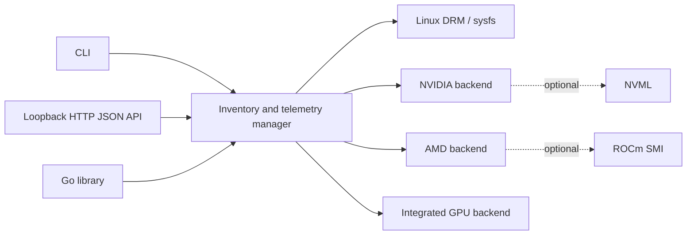

# Hugin Telemetry

**One view of GPU inventory and telemetry across Linux hardware.**

A focused Go library, command-line utility and loopback HTTP API for discovering NVIDIA, AMD and integrated GPUs through a common model. This is a standalone engineering showcase of the original Hugin project's local inventory components; it intentionally excludes cluster control, remote compute and runtime interception.

## Why this exists

GPU inventories and telemetry differ across vendors, drivers and operating-system interfaces. Hugin Telemetry unifies the discovery contract, deduplicates devices by their hardware identity and exposes readings through consistent interfaces.

## Quick start

Requirements: Linux and Go 1.26. A supported GPU and installed driver are needed for meaningful hardware readings. The default build does not require native GPU SDKs.

```bash
git clone https://github.com/GabDevjs/hugin-telemetry.git
cd hugin-telemetry
make build
./bin/hugin version
./bin/hugin list
./bin/hugin list -json
./bin/hugin watch
```

Illustrative CLI output:

```text
IDX  VENDOR  NAME                        PCI           DRM    TYPE      BACKEND
0    nvidia  NVIDIA GeForce RTX 5060 Ti  0000:01:00.0  card0  discrete  nvidia-smi
```

Run the HTTP API locally:

```bash
./bin/hugin serve
# In a second terminal:
curl http://127.0.0.1:8080/healthz
curl http://127.0.0.1:8080/v1/devices
curl http://127.0.0.1:8080/v1/telemetry
```

The HTTP listener defaults to loopback. It is a development API, not an authenticated multi-user service.

## Architecture



| Component | Responsibility |
| --- | --- |
| `pkg/gpu` | Shared device, telemetry and backend contracts; manager and deduplication |
| `pkg/gpu/all` | Registration of built-in vendor backends |
| `pkg/gpu/{sysfs,nvidia,amd,intel}` | Linux and vendor-specific discovery |
| `internal/cli`, `internal/api` | CLI and HTTP presentation layers |

## Engineering decisions

- **Backend abstraction:** use one discovery/telemetry contract so the CLI, API and Go consumers are independent of vendor-specific adapters.
- **Portable default:** prefer sysfs and existing vendor utilities over SDKs at build time; optional native adapters provide richer metrics when available.
- **Deduplication:** prefer the highest-priority backend for a given PCI address or DRM node and backfill identifying fields. Correctness depends on hardware identification and configured priority.
- **Scope:** expose local inventory only. This does not claim production deployment, remote execution or hardware virtualization.
- **Measurement:** unsupported readings vary by driver and must not be interpreted as measured zero. Native adapter paths require representative hardware for validation.

## Validation

```bash
make check
make build
```

The default checks cover portable Go formatting, vet, tests and build. Optional `nvml` and `rocm` build-tag paths require the relevant headers, libraries and hardware; the default CI is not proof that those paths work on every device.

## License

[MIT](LICENSE). The original copyright notice is preserved.
